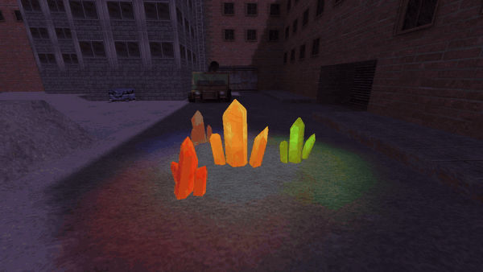

<h1 align="center">Xen Crystal</h1>

<p align="center">
  
</p>

## 📝 Description
This plugin adds a fully dynamic Xen crystal system to Counter-Strike 1.6.
Crystals can be placed, managed and configured during gameplay with runtime control over visibility, team access, activation states and color effects.
- Create and remove Xen crystals during gameplay via an in-game menu
- Multiple crystal shapes with normal and large variants
- Configurable per crystal: solidity, team access, animation speed and spawn chance
- Delayed and timed activation with random ranges for round-based gameplay
- Triggerable crystals that activate when players approach them
- Configurable activation duration and cooldown for triggered crystals
- Optional reverse activation for inverted crystal behavior
- Randomized color changes with configurable frequency
- Dynamic crystal rotation and natural ghost preview placement
- Custom crystal setups are saved per map and automatically loaded on every map start

## 📋 Requirements
- ReGameDLL
- AMX Mod X 1.10+

## 💬 Commands
- `say /xc` - Opens the Xen Crystal menu.
- `say_team /xc` - Opens the Xen Crystal menu.
- `say /xen_crystal` - Opens the Xen Crystal menu.
- `say_team /xen_crystal` - Opens the Xen Crystal menu.
- `xc_reload` - Reloads the configuration file.
- `xencrystal_reload` - Reloads the configuration file.

## ⚙️ Configuration
```ini
# Per-crystal settings (defined under each [Crystal Name] section):
# CRYSTAL_FLAGS              = a - Solid, b - Active Delay, c - Active Duration, d - Reverse, e - Color Random
# CRYSTAL_TEAM               = 0 - None, 1 - Terrorist, 2 - Counter-Terrorist, 3 - Both
# CRYSTAL_FRAMERATE          = Crystal's animation speed
# CRYSTAL_SPAWN_CHANCE       = Crystal's respawn probability (0.0 - 1.0)
# CRYSTAL_ACTIVE_DELAY       = Minimum and maximum activation delay after round start
# CRYSTAL_ACTIVE_DURATION    = Minimum and maximum active state duration
# CRYSTAL_ACTIVE_COOLDOWN    = Minimum and maximum cooldown before reactivation
# CRYSTAL_TRIGGER_DISTANCE   = Distance in units at which the crystal can be triggered by players
# CRYSTAL_TRIGGER_DURATION   = Duration in seconds for which the crystal remains active after being triggered
# CRYSTAL_COLOR_FREQUENCY    = Frequency in seconds at which the crystal's color changes randomly (only applicable if FLAG_COLOR_RANDOM is set)
```

## 🔄 Changelog
```text
* v1.0: Initial release.
```

[](https://www.youtube.com/watch?v=lXNKts-F1LU)
